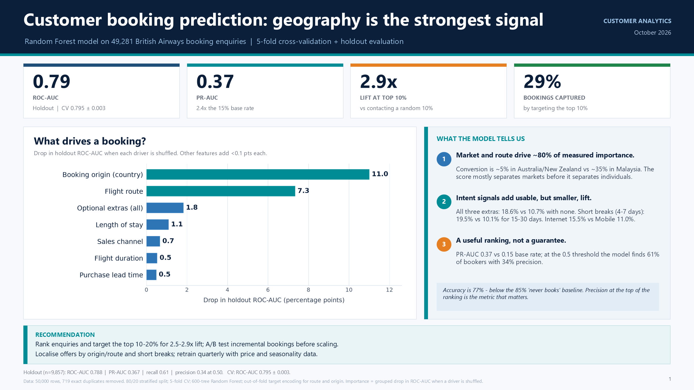

# Predicting customer buying behaviour

End-to-end analysis of 50,000 British Airways booking enquiries: data preparation,
feature engineering, a Random Forest propensity model, evaluation, and a one-slide
manager summary.



## Deliverables

| File | What it is |
|---|---|
| `Predicting_Customer_Booking_Summary.pptx` | **The submission:** one-slide summary for the manager |
| `Predicting_Customer_Booking_Summary.pdf` | PDF render of the slide for quick viewing |
| `customer_booking_analysis.ipynb` | Executed Jupyter notebook with the full analysis |
| `customer_booking_analysis.html` | Static HTML render of the notebook |
| `outputs/customer_booking_features.csv` | Cleaned, feature-engineered dataset (49,281 rows) |
| `outputs/metrics.json` | All evaluation metrics in machine-readable form |
| `outputs/figures/` | EDA, model-evaluation and importance charts |
| `outputs/slide_preview.png` | PNG preview of the slide |
| `analysis/booking_analysis.py` | Reproducible source of the notebook (percent format) |
| `analysis/build_deck.py` | Builds the PowerPoint from the saved artefacts |

## Headline results

- **49,281** unique enquiries after removing 719 exact duplicates; **15.0%** complete a booking.
- **Random Forest** (600 trees, 17 model inputs, out-of-fold target encoding for route and
  booking origin, `class_weight="balanced_subsample"`).
- **5-fold cross-validation:** ROC-AUC **0.795 ± 0.003**, PR-AUC **0.391 ± 0.011**, F1 **0.451 ± 0.004**.
- **Holdout (9,857 customers):** ROC-AUC **0.788**, PR-AUC **0.367** vs 0.150 prevalence,
  accuracy 76.8%, recall 60.6%, precision 34.4%, F1 0.439.
- **Targeting lift:** contacting the top 10% captures **28.6% of bookings (2.86x lift)**;
  the top 20% captures **50.3% (2.51x lift)**.
- **Strongest drivers (drop in holdout ROC-AUC when shuffled):** booking origin **11.0 pts**,
  flight route **7.3 pts**, optional extras **1.8 pts**, length of stay **1.1 pts**,
  sales channel **0.7 pts**, flight duration **0.5 pts**, purchase lead time **0.5 pts**.
  Together, origin and route account for ~80% of measured importance.

## Approach

1. **Data quality** — no missing values; 719 exact duplicates removed; target imbalance
   documented (85/15). Accuracy is explicitly treated as misleading.
2. **EDA** — conversion by market, route, channel, trip type, stay length, lead time,
   extras and departure time; numeric correlations are weak, motivating a tree model.
3. **Feature engineering** — day-of-week numeric, weekend flag, extras count, cyclical
   departure-hour transforms. High-cardinality `route`/`booking_origin` are target-encoded
   out-of-fold inside the pipeline.
4. **Modelling** — Random Forest with 5-fold stratified CV on the training set only; a
   regularised logistic regression benchmark is included for context.
5. **Evaluation** — holdout ROC-AUC/PR-AUC, confusion matrix at 0.5, cumulative gains and
   lift by targeting depth.
6. **Interpretation** — permutation importance on raw features and grouped permutation
   importance for correlated feature families; no causal claims.

## Reproduce

```powershell
python -m pip install -r requirements.txt

# Run the analysis, save figures/metrics and the prepared dataset
python analysis/booking_analysis.py

# Regenerate the notebook from the percent-format source and execute it
jupytext --to notebook analysis/booking_analysis.py -o customer_booking_analysis.ipynb
jupyter nbconvert --to notebook --execute --inplace customer_booking_analysis.ipynb
jupyter nbconvert --to html customer_booking_analysis.ipynb --output customer_booking_analysis.html

# Rebuild the slide
python analysis/build_deck.py
```

The analysis uses `RANDOM_STATE = 42` throughout, so results are reproducible.

## Caveats

- **No PowerPoint template was present in the workspace.** The deck is a custom,
  single-slide 16:9 summary designed to match the task brief. It can be pasted into a
  corporate template if one is supplied.
- **Possible leakage in the optional-extra fields.** `wants_extra_baggage`,
  `wants_preferred_seat` and `wants_in_flight_meals` are captured during the booking
  journey. The sensitivity check without them gives holdout ROC-AUC 0.781 and PR-AUC 0.352
  (vs 0.788 / 0.367 with them). Confirm they are known before payment before deploying.
- **Predictive, not causal.** Origin and route are the strongest predictors because markets
  have different historic conversion rates, not because geography causes booking. The
  recommendation is to A/B test any campaign.
- **Limited feature set.** Price, travel dates/seasonality, repeat-customer history and
  abandoned-search behaviour are absent and are likely to add more signal than further
  tuning of the current columns.
- **Duplicates.** Exact duplicates were removed to avoid overweighting identical profiles.
  If they represent genuinely separate customers, the effective sample is slightly larger.
